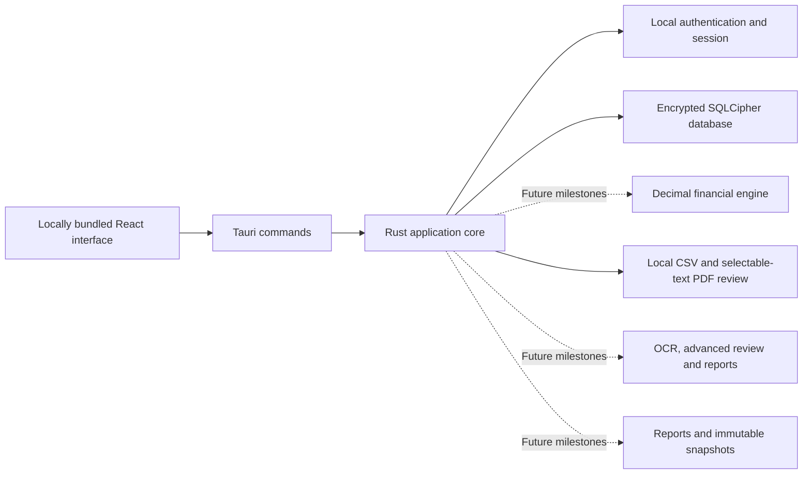

# Architecture and development

## Supported target and first milestone

Windows 11 x64 is the first distribution target. Tauri 2 provides the native desktop host, React and TypeScript provide the interface, Rust owns authentication and persistence, and SQLCipher encrypts the local SQLite database. Development builds on Linux help validate code and local workflows; Windows installation and offline runtime behavior require a Windows machine.

The first milestone is intentionally limited to a working local counselor-and-client workflow. The complete specification is in [product-specification.md](product-specification.md). The unavailable workbook is a future reference to inspect only with authorized access; it is not a runtime dependency.

## Boundaries

| Layer | Responsibility in the first milestone |
| --- | --- |
| React interface | Local setup, sign-in, navigation, client forms, notes, clear validation and error states |
| Tauri command boundary | Narrow native commands, serializable request/response types, access to managed application state |
| Rust application core | Input validation, authenticated-session checks, organization ownership, lifecycle transitions |
| Persistence | Versioned schema, SQLCipher access, transactional writes, parameterized queries, audit records |
| Authentication | Password-based key derivation, opening the encrypted database, session lock/unlock |

The first financial module, `budget.rs`, owns exact cent arithmetic, normalized monthly budget totals, and missing/estimated planning flags. Budgets are scoped to the authenticated client in encrypted schema 3, saved atomically with audit events, and use optimistic revisions to prevent stale overwrites. `debt.rs` adds fixed-monthly APR repayment schedules, snowball/avalanche comparison, payment events, and budget-capacity review. Debt inputs are stored in encrypted schema 4 with the same scope/revision/audit safeguards; projections are recomputed and do not alter historical transactions. `savings.rs` adds liquid-pool reserve accounting, necessary-expense emergency coverage, dated sinking-fund goals, capped contribution forecasts, and budget/debt funding checks. Inputs are stored in schema 5 with the same authenticated revision/audit protections. `cashflow.rs` adds exact dated balances per account, recurrence, paired transfers, conservative same-day shortfall review, and non-writing date previews. Schema 6 uses the same scope/revision/atomic audit protections. Dated schedules are entered independently, with budget/debt/savings amounts shown as references rather than invented transactions. `storage::backup` implements authenticated encrypted SQLCipher snapshots, native folder/file selection, staged verification/migration, and atomic activation of a new private workspace generation. Schema 7 adds backup/restore audit events without altering prior immutable history. The previous database/metadata pair is retained, and stale sessions lock when another instance activates a restore. See [backup-recovery.md](backup-recovery.md) for the format, durability limits, and failure behavior. `imports.rs` parses explicitly mapped, bounded UTF-8 CSVs and calculates approved-only exact-cent totals. `storage::imports_store` enforces authenticated client ownership, optimistic revisions, atomic decisions/audit, immutable provenance/history, duplicate advisories, and reciprocal transfer approval. Schema 8 stores authorized complete sources inside SQLCipher; backups include these BLOBs and validate imported financial records during restore. See [csv-import-review.md](csv-import-review.md). `pdf.rs` extracts bounded selectable text and creates immutable page/line records only from counselor-selected lines. `pdf_process.rs` supervises a separate executable process with sanitized environment, input/output, memory/CPU/wall limits and no workspace initialization; PDF rows always require individual verification. Schema 9 adds PDF audit events while preserving prior sources/history; authorized originals remain SQLCipher BLOBs included in backups. See [pdf-import-review.md](pdf-import-review.md) for format, limits, and the distinction between process boundaries and a complete OS sandbox. `recurring.rs` derives conservative historical payment groups from approved expenses/fees and hashes source facts plus exact approval IDs. Schema 11 stores append-only evidence-bound counselor decisions; import revisions, atomic audit, authenticated scope and restore validation reuse `storage::imports_store`. Source corrections/reversals invalidate current decisions without deleting their captured evidence. See [recurring-payment-review.md](recurring-payment-review.md). `reconciliation.rs` compares declared after-transaction CSV balances using independent original local steps and approved-only cumulative movements. Missing/undecided data stays unknown, rejected rows never supply approved anchors, and date conflicts prevent silent sorting. Schema 12 stores scoped append-only order choices; source corrections/reversals recompute comparisons, and restore validates settings. See [statement-balance-reconciliation.md](statement-balance-reconciliation.md). `dashboard.rs` reads current authenticated imports without writing, applies bounded complete-month periods, reuses exact approved-data arithmetic and produces integer chart scales. React renders local SVG charts and rejects mismatched client/revision results; planning and unverified balances never supply approved metrics. See [financial-dashboard.md](financial-dashboard.md). `financial_facts.rs` validates explicit classifications bound to immutable approval IDs and dated counselor-verified balance inventories; schema 13 stores append-only snapshots in `financial_fact_reviews`. Scoped reads/recovery validate historical source bindings, and shared import revisions/audit protect writes. The dashboard calculates dated inventory metrics and conservative recorded-data ratios without reading plans. See [verified-financial-facts.md](verified-financial-facts.md). `assessments.rs` captures approved-data snapshots and exact supporting decisions; `storage::assessments_store` stores scoped append-only records in schema 14 with stale-context checks, atomic audit and integrity/arithmetic validation. Reads flag source/profile changes without rewriting the captured JSON. Recovery validates all records before activation. See [saved-assessments.md](saved-assessments.md). `assessment_pdf.rs` renders validated historical records using bundled typography and local vector charts, then publishes a local plaintext PDF without replacing existing files. The storage command rechecks scoped authentication and review status at export. See [assessment-pdf-export.md](assessment-pdf-export.md). `planning.rs` captures named saved-plan scenarios with explicit repayment selection, exact inputs/outputs and shared pure budget/debt/savings/cash-flow contexts. Format 2 assessment payloads optionally attach them; format 1 records stay unchanged. Scoped reads/export flag plan revision changes, and recovery recomputes only from captured inputs for validation. See [captured-planning-scenarios.md](captured-planning-scenarios.md). `action_plans.rs` derives exact agreed allocations and canonical prioritized guidance from a current immutable assessment/scenario. `storage::action_plans_store` stores scoped append-only format 1 plans in schema 15 with composite parent identity, atomic audit, digest/derived-value validation and recovery checks. Shared PDF rendering produces client guidance with preserved warnings; later supporting changes flag history without rewriting it. Bundled `chrono-tz` owns offline America/Chicago report dates. See [client-action-plans.md](client-action-plans.md). `report_evidence.rs` validates selected append-only session notes and captured latest payment decisions in format 3 assessments. Capture retains their older approval bindings, and read/export/recovery recheck note identity against scoped original storage and recompute historical payment groups. Note-count changes flag context without rewriting report bytes. See [counselor-report-evidence.md](counselor-report-evidence.md). `budget_methods.rs` computes temporary zero-based/50-30-20/custom references from canonical saved budgets, with integer basis-point/largest-remainder targets and explicit minimum-debt classification. The scoped read-only command checks the saved revision; React collects strings and renders returned figures without changing plans or source records. See [budget-method-comparisons.md](budget-method-comparisons.md). Remaining financial calculations and OCR/adapters belong in separate Rust modules with independent tests. React components must not become the authoritative calculation engine. Money uses exact integer cents and documented rounding; the import review workflow separates approved facts from planning estimates and rejected data.



There is no required cloud service, spreadsheet integration, or shared network database. Each installation owns its local data directory. Development dependency downloads and Windows installer build downloads are separate from the installed application's essential offline workflow.

`client_care.rs` validates optional intake and explicit task/appointment dates and calculates due counts in America/Chicago. `storage::client_care_store` appends scoped, canonical schema-17 snapshots with optimistic revisions and atomic audit. Recovery validates all versions and retained task identities. `ClientCare` guards drafts and delayed responses without supplying financial facts or rewriting report history. See [client-intake-followups.md](client-intake-followups.md).

`follow_up_overview.rs` derives scoped date-only practice counts, filters, stable ordering and 25-item pages. `client_care_store` reads matching client identities and latest versions in one SQLite snapshot. `FollowUpOverview` renders the read-only dashboard and opens the current client/item through guarded navigation; `ClientCare` focuses that item. Schema 17 is unchanged. See [follow-up-overview.md](follow-up-overview.md).

## Data model and ownership

Organization, counselor, client, note, and audit records use internal identifiers. The first installation creates one organization and counselor; this is not a completed multi-user permission system. Queries must derive the organization from the authenticated session and constrain records by that organization in Rust. Interface filtering alone is insufficient.

Client lifecycle states follow the specification: New Intake, Information Collection, Financial Review, Planning, Action Plan, Follow-Up, and Archived. Notes retain their author and creation time and are appended rather than silently overwritten. Audit entries record material operations without storing passwords, keys, or complete sensitive record contents.

The encrypted database stores the schema version. Future migrations must be tested against older databases and avoid leaving partially migrated state. Future transaction, financial-account, document, scenario, and report tables must retain client and organization ownership. Approved historical facts and hypothetical planning scenarios must remain distinct.

## Development checks

Run commands from the repository directory:

```sh
npm ci
npm run build
npm test
cargo test --manifest-path src-tauri/Cargo.toml --locked
npm run tauri dev
```

The build type-checks and bundles the interface. Frontend tests exercise meaningful interactions. Rust tests exercise encryption, local authentication, persistence, validation, and record isolation. [Development status](development-status.md) distinguishes checks executed in this environment from tests that remain pending.

For native development on Ubuntu/Debian, Tauri 2 ordinarily requires a C/C++ build toolchain, `pkg-config`, `libwebkit2gtk-4.1-dev`, `libgtk-3-dev`, `libayatana-appindicator3-dev`, `librsvg2-dev`, `patchelf`, and OpenSSL development support. SQLCipher/OpenSSL source builds may need additional compiler prerequisites. Follow [cloud-development.md](cloud-development.md) for the scripts that install and activate these dependencies in the actual managed cloud environment.

Cloud tasks already use an isolated environment: reuse the checkout under `/workspace/eisenbart-co-desktop` and do not create a Git worktree unless requested. Use frozen dependency installation (`npm ci`) and locked Rust builds. Keep dependency caches and generated build outputs separate from committed source. Startup processes must be relaunched in a new cloud task; retained build files do not mean the desktop process is still running.

## Windows packaging

The Windows workflow builds an NSIS installer with Tauri's `offlineInstaller` WebView2 mode. This is intended to include the WebView2 runtime installer so the resulting package can install without fetching that component during installation. Building it requires network access to obtain dependencies and the runtime redistributable.

The packaging configuration must be exercised on Windows. Merely committing the workflow does not produce an executable, verify the NSIS installer, demonstrate offline installation, or provide a signing certificate. Follow [windows.md](windows.md) for the build and release checks.

Combined scenario previews (`combined-preview-v1`) read all four scoped saved models atomically, validate the baseline and expected versions, and recalculate an indexed proposal with the same Rust calculators and shared contexts. React sends input strings only; no scenario or live-plan write occurs. Dated entries require explicit edits. Historical captures retain `entered-plans-v1` unchanged. See [combined-scenario-comparisons.md](combined-scenario-comparisons.md).

`saved_scenarios.rs` and `storage::scenarios_store` add schema 16 immutable combined proposals. Inputs/counts/versions are checked in a scoped atomic save, all captured calculations are recomputed on read/recovery, and compound append-only links bind selected format 4 assessments to their original proposed model sets. Formats 1–3 remain supported. Internal PDF export validates the linked record and prints selected comparison context separately from approved totals. See [saved-combined-scenarios.md](saved-combined-scenarios.md).

Optional combined proposal extensions add dated debt extras and indexed existing-goal contributions, retaining empty-field/warning compatibility for earlier immutable captures. They reuse the original Rust calculators and report/recovery provenance; schema 16 is unchanged. See [scenario-payment-goal-controls.md](scenario-payment-goal-controls.md).

`report_intake.rs` canonicalizes explicit address/household/employment selections;
`storage::report_intake_store` captures the expected saved care version inside
the assessment transaction, validates original selected values/timestamps on
read/recovery and checks later bounded care versions for permanent selected-field
changes. Format-5 payloads retain only selected intake fields. Optional omission
preserves formats 1–4 bytes/digests; schema 17 is unchanged. Internal PDF export
prints counselor context separately from financial facts. The client-plan PDF
renderer excludes it. See [report-intake-context.md](report-intake-context.md).

`workspaceNavigation.ts` defines the twelve specification sections. `App` retains
an authenticated in-memory client context across focused pages, ignores late
selection responses and guards persistent drafts/busy operations. Page/area
changes focus the heading. `ClientEditor` remounts the relevant existing workflow;
`ImportsEditor` presents document/transaction/review/report views over the same
scoped Rust data. Complete record remains available. `AdministrationPages` and
`PlannedWorkspaceAreas` distinguish working tools from named future sections;
[prototype-development-map.md](prototype-development-map.md) records implementation
entry points and acceptance criteria. Schema 17 and report formats are unchanged.
